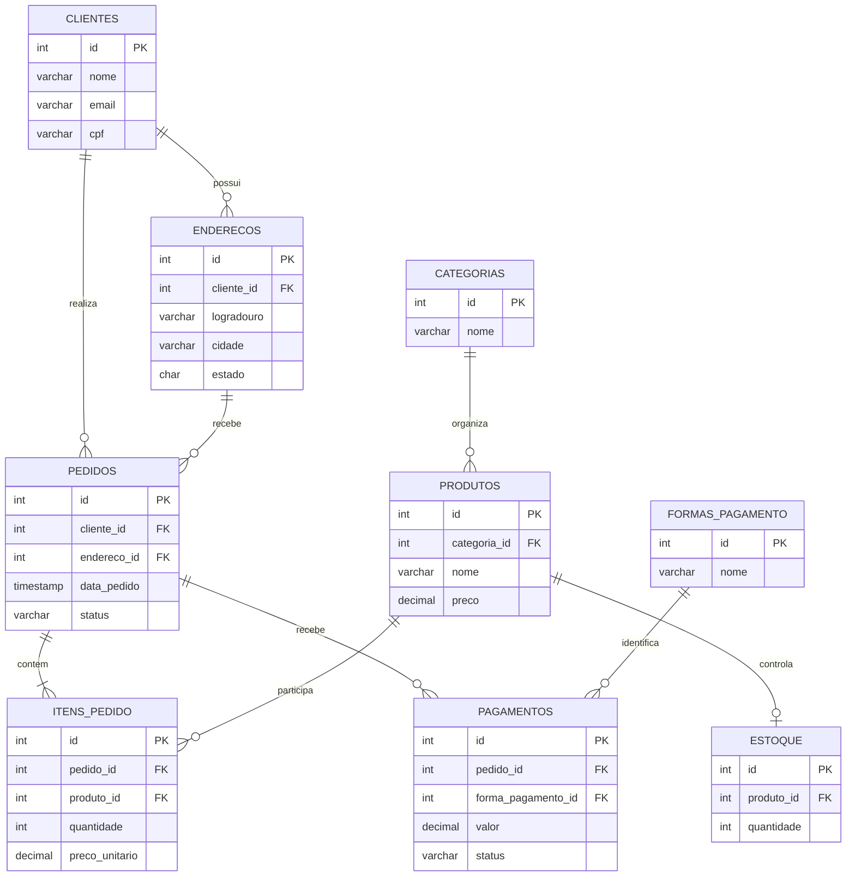

# Modelagem de Banco de Dados – Loja Virtual

## 1. Introdução

A modelagem de banco de dados é uma das etapas mais importantes no desenvolvimento de um sistema. Ela permite organizar as informações, estabelecer relacionamentos entre os dados e garantir a integridade das informações armazenadas.

Neste material, vamos desenvolver a modelagem de um banco de dados para uma **Loja Virtual (E-commerce)**, considerando funcionalidades como:

- Cadastro de clientes.
- Cadastro de produtos.
- Categorias de produtos.
- Controle de estoque.
- Carrinho de compras.
- Pedidos.
- Itens dos pedidos.
- Pagamentos.
- Endereços de entrega.
- Formas de pagamento.

Além disso, estudaremos as quatro principais formas normais de banco de dados:

1. Primeira Forma Normal (1FN).
2. Segunda Forma Normal (2FN).
3. Terceira Forma Normal (3FN).
4. Quarta Forma Normal (4FN).

---

# 2. Levantamento de Requisitos

Antes de criar as tabelas, precisamos entender como o sistema deverá funcionar.

Imagine que estamos desenvolvendo uma loja virtual que comercializa produtos de informática.

O sistema deverá permitir que:

1. Um cliente realize seu cadastro.
2. Um cliente possua um ou mais endereços.
3. Um produto pertença a uma categoria.
4. Um cliente realize vários pedidos.
5. Um pedido contenha vários produtos.
6. Um produto possa aparecer em vários pedidos.
7. Cada pedido possua uma forma de pagamento.
8. Um pedido tenha informações de entrega.
9. O estoque seja controlado individualmente por produto.

Essas regras serão utilizadas para construir nosso modelo de dados.

# 3. Identificando as Entidades

Uma entidade representa algo importante para o negócio e que precisa ser armazenado no banco de dados.

Para nossa loja virtual, identificamos as seguintes entidades:

| Entidade | Responsabilidade |
|---|---|
| clientes | Armazenar os clientes |
| enderecos | Armazenar os endereços dos clientes |
| categorias | Organizar os produtos |
| produtos | Armazenar os produtos |
| pedidos | Armazenar as compras |
| itens_pedido | Armazenar os produtos de cada pedido |
| pagamentos | Armazenar os pagamentos |
| formas_pagamento | Armazenar as formas de pagamento |
| estoque | Controlar a quantidade disponível |

## 3.1. Relacionamentos

Agora precisamos identificar como essas entidades se relacionam.

- Um cliente pode realizar vários pedidos.
- Um cliente pode possuir vários endereços.
- Uma categoria pode possuir vários produtos.
- Um pedido pode possuir vários itens.
- Um produto pode aparecer em vários pedidos.
- Um pedido pode possuir um ou mais registros de pagamento.
- Uma forma de pagamento pode ser utilizada em vários pagamentos.

## 3.2. Modelo de relacionamento

| Relacionamento | Cardinalidade |
|---|---|
| Cliente → Pedidos | 1:N |
| Cliente → Endereços | 1:N |
| Categoria → Produtos | 1:N |
| Pedido → Itens | 1:N |
| Produto → Itens | 1:N |
| Pedido → Pagamentos | 1:N |
| Forma de pagamento → Pagamentos | 1:N |

**Atenção:** O relacionamento entre pedidos e produtos é N:N (muitos para muitos). Para resolver esse relacionamento, criamos a tabela intermediária `itens_pedido`.

---

# 4. Construindo o Modelo de Dados

Agora vamos transformar os requisitos em tabelas.

## 4.1. Tabela clientes

Responsável por armazenar os dados dos clientes.

| Campo | Tipo | Descrição |
|---|---|---|
| id | INT | Chave primária |
| nome | VARCHAR(150) | Nome do cliente |
| email | VARCHAR(150) | E-mail |
| cpf | VARCHAR(14) | CPF |
| telefone | VARCHAR(20) | Telefone |
| criado_em | TIMESTAMP | Data de cadastro |

## 4.2. Tabela enderecos

Um cliente pode possuir vários endereços.

| Campo | Tipo | Descrição |
|---|---|---|
| id | INT | Chave primária |
| cliente_id | INT | Chave estrangeira |
| logradouro | VARCHAR(150) | Rua ou avenida |
| numero | VARCHAR(20) | Número |
| complemento | VARCHAR(100) | Complemento |
| bairro | VARCHAR(100) | Bairro |
| cidade | VARCHAR(100) | Cidade |
| estado | CHAR(2) | UF |
| cep | VARCHAR(10) | CEP |

## 4.3. Tabela categorias

| Campo | Tipo | Descrição |
|---|---|---|
| id | INT | Chave primária |
| nome | VARCHAR(100) | Nome da categoria |
| descricao | TEXT | Descrição |

## 4.4. Tabela produtos

| Campo | Tipo | Descrição |
|---|---|---|
| id | INT | Chave primária |
| categoria_id | INT | Chave estrangeira |
| nome | VARCHAR(150) | Nome do produto |
| descricao | TEXT | Descrição |
| preco | DECIMAL(10,2) | Preço de venda |
| ativo | BOOLEAN | Produto ativo |

## 4.5. Tabela estoque

| Campo | Tipo | Descrição |
|---|---|---|
| id | INT | Chave primária |
| produto_id | INT | Chave estrangeira |
| quantidade | INT | Quantidade disponível |
| atualizado_em | TIMESTAMP | Última atualização |

## 4.6. Tabela pedidos

| Campo | Tipo | Descrição |
|---|---|---|
| id | INT | Chave primária |
| cliente_id | INT | Chave estrangeira |
| endereco_id | INT | Endereço de entrega |
| data_pedido | TIMESTAMP | Data da compra |
| status | VARCHAR(30) | Situação do pedido |
| valor_total | DECIMAL(10,2) | Total do pedido |

## 4.7. Tabela itens_pedido

Essa tabela representa os produtos que fazem parte de cada pedido.

| Campo | Tipo | Descrição |
|---|---|---|
| id | INT | Chave primária |
| pedido_id | INT | Chave estrangeira |
| produto_id | INT | Chave estrangeira |
| quantidade | INT | Quantidade comprada |
| preco_unitario | DECIMAL(10,2) | Preço no momento da compra |

**Importante:** O preço unitário deve ser registrado no item do pedido para preservar o valor praticado no momento da compra, mesmo que o preço atual do produto seja alterado.

## 4.8. Tabela formas_pagamento

| Campo | Tipo | Descrição |
|---|---|---|
| id | INT | Chave primária |
| nome | VARCHAR(50) | Nome da forma de pagamento |

Exemplos: PIX, cartão de crédito, cartão de débito e boleto.

## 4.9. Tabela pagamentos

| Campo | Tipo | Descrição |
|---|---|---|
| id | INT | Chave primária |
| pedido_id | INT | Chave estrangeira |
| forma_pagamento_id | INT | Chave estrangeira |
| valor | DECIMAL(10,2) | Valor pago |
| status | VARCHAR(30) | Situação do pagamento |
| data_pagamento | TIMESTAMP | Data do pagamento |

---

# 5. O que são Normalizações de Banco de Dados?

Normalização é um processo utilizado para organizar os dados em tabelas, reduzindo redundâncias e evitando problemas de inserção, atualização e exclusão.

Imagine uma tabela que armazena clientes, produtos, pedidos e pagamentos em uma única estrutura.

Isso pode gerar problemas como:

- Informações repetidas.
- Dificuldade para atualizar registros.
- Inconsistência dos dados.
- Desperdício de espaço.
- Dificuldade para realizar consultas.

Para resolver esses problemas, aplicamos as formas normais.

# 6. Primeira Forma Normal (1FN)

## Conceito

Uma tabela está na Primeira Forma Normal quando:

- Cada coluna possui valores atômicos (indivisíveis no contexto do modelo).
- Não existem grupos de valores repetidos em uma mesma coluna.
- Cada registro pode ser identificado individualmente por uma chave.

## Exemplo incorreto

Imagine uma tabela de pedidos:

| pedido_id | cliente | produtos |
|---|---|---|
| 1 | João | Mouse, Teclado, Monitor |
| 2 | Maria | Notebook, Mouse |

Observe que a coluna `produtos` armazena vários valores em uma única célula.

Isso dificulta consultas, filtros e relacionamentos.

## Aplicando a 1FN

Precisamos separar os produtos em registros individuais.

| pedido_id | cliente | produto |
|---|---|---|
| 1 | João | Mouse |
| 1 | João | Teclado |
| 1 | João | Monitor |
| 2 | Maria | Notebook |
| 2 | Maria | Mouse |

Agora cada campo possui apenas um valor.

**Resultado:** A tabela passa a respeitar a atomicidade dos dados.

---

# 7. Segunda Forma Normal (2FN)

## Conceito

Uma tabela está na Segunda Forma Normal quando:

- Já atende à Primeira Forma Normal.
- Todos os atributos que não fazem parte da chave dependem da chave inteira.
- Não existem dependências parciais em relação a uma chave primária composta.

A 2FN é especialmente importante quando utilizamos chaves primárias compostas.

## Exemplo incorreto

Imagine uma tabela que armazena os produtos de cada pedido.

A chave primária é composta por `pedido_id` e `produto_id`.

| pedido_id | produto_id | nome_produto | quantidade |
|---|---|---|---|
| 1 | 10 | Mouse | 2 |
| 1 | 11 | Teclado | 1 |
| 2 | 10 | Mouse | 3 |

Observe que:

- `quantidade` depende do pedido e do produto.
- `nome_produto` depende somente do produto.

Portanto, existe uma dependência parcial.

## Aplicando a 2FN

Vamos separar os dados em duas tabelas.

### Tabela produtos

| produto_id | nome_produto |
|---|---|
| 10 | Mouse |
| 11 | Teclado |

### Tabela itens_pedido

| pedido_id | produto_id | quantidade |
|---|---|---|
| 1 | 10 | 2 |
| 1 | 11 | 1 |
| 2 | 10 | 3 |

Agora:

- O nome do produto pertence à tabela produtos.
- A quantidade pertence à relação entre pedido e produto.

**Resultado:** Eliminamos a dependência parcial.

---

# 8. Terceira Forma Normal (3FN)

## Conceito

Uma tabela está na Terceira Forma Normal quando:

- Já atende à Segunda Forma Normal.
- Não existem dependências transitivas entre atributos não-chave.
- Os atributos não-chave dependem diretamente da chave primária.

## Exemplo incorreto

Imagine uma tabela de clientes:

| cliente_id | nome | cidade_id | cidade | estado |
|---|---|---|---|---|
| 1 | João | 10 | Fortaleza | CE |
| 2 | Maria | 10 | Fortaleza | CE |
| 3 | Pedro | 20 | Recife | PE |

Observe que:

- `cliente_id` determina `cidade_id`.
- `cidade_id` determina `cidade` e `estado`.

Portanto, os dados da cidade dependem indiretamente do cliente.

Isso representa uma dependência transitiva.

## Aplicando a 3FN

Vamos separar as informações.

### Tabela clientes

| cliente_id | nome | cidade_id |
|---|---|---|
| 1 | João | 10 |
| 2 | Maria | 10 |
| 3 | Pedro | 20 |

### Tabela cidades

| cidade_id | cidade | estado |
|---|---|---|
| 10 | Fortaleza | CE |
| 20 | Recife | PE |

Agora, os dados da cidade são armazenados apenas uma vez.

**Resultado:** Eliminamos a dependência transitiva e reduzimos a repetição de informações.

---

# 9. Quarta Forma Normal (4FN)

## Conceito

A Quarta Forma Normal trata de um problema mais específico: as dependências multivaloradas.

Uma tabela está na 4FN quando:

- Já atende à Terceira Forma Normal.
- Não possui dependências multivaloradas não triviais, exceto quando determinadas por uma superchave.

Em outras palavras, precisamos evitar misturar na mesma tabela dois ou mais conjuntos de informações independentes que possuem vários valores para uma mesma entidade.

## Exemplo prático

Imagine que nossa loja virtual comercializa camisetas.

Um produto pode possuir várias cores e vários tamanhos.

Produto: Camiseta Básica.

Cores disponíveis:
- Preto.
- Branco.
- Azul.

Tamanhos disponíveis:
- P.
- M.
- G.

Imagine que as cores e os tamanhos são independentes entre si e que todas as combinações são possíveis.

## Exemplo incorreto

| produto | cor | tamanho |
|---|---|---|
| Camiseta | Preto | P |
| Camiseta | Preto | M |
| Camiseta | Preto | G |
| Camiseta | Branco | P |
| Camiseta | Branco | M |
| Camiseta | Branco | G |
| Camiseta | Azul | P |
| Camiseta | Azul | M |
| Camiseta | Azul | G |

Observe que precisamos armazenar todas as combinações de cores e tamanhos.

Isso provoca uma combinação de informações independentes.

## Aplicando a 4FN

Vamos separar as informações em tabelas distintas.

### Tabela produtos

| produto_id | nome |
|---|---|
| 1 | Camiseta Básica |

### Tabela produto_cores

| produto_id | cor |
|---|---|
| 1 | Preto |
| 1 | Branco |
| 1 | Azul |

### Tabela produto_tamanhos

| produto_id | tamanho |
|---|---|
| 1 | P |
| 1 | M |
| 1 | G |

Agora as cores e os tamanhos são armazenados independentemente.

**Resultado:** Eliminamos a redundância provocada pela combinação de conjuntos multivalorados independentes.

**Observação importante:** Se determinadas cores só estiverem disponíveis em determinados tamanhos, não devemos separar as informações dessa maneira. Nesse caso, precisamos representar as combinações válidas em uma tabela de variantes do produto.

---

# 10. Comparação das Quatro Formas Normais

| Forma normal | Principal objetivo |
|---|---|
| 1FN | Eliminar grupos repetidos e valores não atômicos |
| 2FN | Eliminar dependências parciais |
| 3FN | Eliminar dependências transitivas |
| 4FN | Eliminar dependências multivaloradas independentes |

## Resumo para memorizar

- **1FN:** Cada campo deve armazenar um valor.
- **2FN:** Cada atributo deve depender da chave inteira.
- **3FN:** Cada atributo deve depender diretamente da chave.
- **4FN:** Não misturar conjuntos multivalorados independentes.

---

# 11. Modelo Relacional Completo da Loja Virtual

Após identificar as entidades, relacionamentos e aplicar os conceitos de normalização, podemos organizar nosso banco de dados da seguinte maneira:

```text
CLIENTES
   |
   | 1:N
   |
   +------ ENDERECOS
   |
   |
   +------ PEDIDOS
               |
               | 1:N
               |
               +------ ITENS_PEDIDO ------ PRODUTOS
               |                              |
               |                              |
               |                              +------ CATEGORIAS
               |                              |
               |                              +------ ESTOQUE
               |
               +------ PAGAMENTOS
                              |
                              |
                              +------ FORMAS_PAGAMENTO
```

## 11.1. Diagrama de entidades e relacionamentos



---

# 12. Exemplo de Implementação SQL – PostgreSQL

Agora vamos transformar nosso modelo em tabelas reais utilizando SQL.

### Criando o banco de dados

```sql
CREATE DATABASE loja_virtual;
```

Conecte-se ao banco de dados `loja_virtual` antes de executar os próximos comandos.

### Criando a tabela clientes

```sql
CREATE TABLE clientes (
    id SERIAL PRIMARY KEY,
    nome VARCHAR(150) NOT NULL,
    email VARCHAR(150) UNIQUE NOT NULL,
    cpf VARCHAR(14) UNIQUE NOT NULL,
    telefone VARCHAR(20),
    criado_em TIMESTAMP DEFAULT CURRENT_TIMESTAMP
);
```

### Criando a tabela enderecos

```sql
CREATE TABLE enderecos (
    id SERIAL PRIMARY KEY,
    cliente_id INT NOT NULL,
    logradouro VARCHAR(150) NOT NULL,
    numero VARCHAR(20),
    complemento VARCHAR(100),
    bairro VARCHAR(100),
    cidade VARCHAR(100),
    estado CHAR(2),
    cep VARCHAR(10),

    FOREIGN KEY (cliente_id)
        REFERENCES clientes(id)
);
```

### Criando a tabela categorias

```sql
CREATE TABLE categorias (
    id SERIAL PRIMARY KEY,
    nome VARCHAR(100) NOT NULL,
    descricao TEXT
);
```

### Criando a tabela produtos

```sql
CREATE TABLE produtos (
    id SERIAL PRIMARY KEY,
    categoria_id INT NOT NULL,
    nome VARCHAR(150) NOT NULL,
    descricao TEXT,
    preco DECIMAL(10,2) NOT NULL CHECK (preco >= 0),
    ativo BOOLEAN DEFAULT TRUE,

    FOREIGN KEY (categoria_id)
        REFERENCES categorias(id)
);
```

### Criando a tabela estoque

```sql
CREATE TABLE estoque (
    id SERIAL PRIMARY KEY,
    produto_id INT UNIQUE NOT NULL,
    quantidade INT NOT NULL DEFAULT 0 CHECK (quantidade >= 0),
    atualizado_em TIMESTAMP DEFAULT CURRENT_TIMESTAMP,

    FOREIGN KEY (produto_id)
        REFERENCES produtos(id)
);
```

### Criando a tabela pedidos

```sql
CREATE TABLE pedidos (
    id SERIAL PRIMARY KEY,
    cliente_id INT NOT NULL,
    endereco_id INT NOT NULL,
    data_pedido TIMESTAMP DEFAULT CURRENT_TIMESTAMP,
    status VARCHAR(30) DEFAULT 'PENDENTE',
    valor_total DECIMAL(10,2) DEFAULT 0,

    FOREIGN KEY (cliente_id)
        REFERENCES clientes(id),

    FOREIGN KEY (endereco_id)
        REFERENCES enderecos(id)
);
```

### Criando a tabela itens_pedido

```sql
CREATE TABLE itens_pedido (
    id SERIAL PRIMARY KEY,
    pedido_id INT NOT NULL,
    produto_id INT NOT NULL,
    quantidade INT NOT NULL CHECK (quantidade > 0),
    preco_unitario DECIMAL(10,2) NOT NULL,

    FOREIGN KEY (pedido_id)
        REFERENCES pedidos(id),

    FOREIGN KEY (produto_id)
        REFERENCES produtos(id),

    UNIQUE (pedido_id, produto_id)
);
```

### Criando a tabela formas_pagamento

```sql
CREATE TABLE formas_pagamento (
    id SERIAL PRIMARY KEY,
    nome VARCHAR(50) NOT NULL
);
```

### Criando a tabela pagamentos

```sql
CREATE TABLE pagamentos (
    id SERIAL PRIMARY KEY,
    pedido_id INT NOT NULL,
    forma_pagamento_id INT NOT NULL,
    valor DECIMAL(10,2) NOT NULL,
    status VARCHAR(30) DEFAULT 'PENDENTE',
    data_pagamento TIMESTAMP,

    FOREIGN KEY (pedido_id)
        REFERENCES pedidos(id),

    FOREIGN KEY (forma_pagamento_id)
        REFERENCES formas_pagamento(id)
);
```

---

# 13. Consultas para testar o banco de dados

Depois de criar as tabelas, podemos executar algumas consultas para verificar os relacionamentos.

### 13.1. Listar produtos e categorias

```sql
SELECT
    p.id,
    p.nome AS produto,
    p.preco,
    c.nome AS categoria
FROM produtos p
INNER JOIN categorias c
    ON c.id = p.categoria_id;
```

### 13.2. Consultar pedidos dos clientes

```sql
SELECT
    p.id AS pedido,
    c.nome AS cliente,
    p.data_pedido,
    p.status,
    p.valor_total
FROM pedidos p
INNER JOIN clientes c
    ON c.id = p.cliente_id;
```

### 13.3. Consultar os produtos de cada pedido

```sql
SELECT
    p.id AS pedido,
    c.nome AS cliente,
    pr.nome AS produto,
    ip.quantidade,
    ip.preco_unitario,
    (ip.quantidade * ip.preco_unitario) AS subtotal
FROM pedidos p
INNER JOIN clientes c
    ON c.id = p.cliente_id
INNER JOIN itens_pedido ip
    ON ip.pedido_id = p.id
INNER JOIN produtos pr
    ON pr.id = ip.produto_id;
```

### 13.4. Consultar o estoque

```sql
SELECT
    p.nome,
    e.quantidade
FROM produtos p
INNER JOIN estoque e
    ON e.produto_id = p.id;
```

---

# 14. Boas práticas de modelagem

Ao desenvolver bancos de dados para sistemas comerciais, considere:

1. Definir uma chave primária para cada tabela.
2. Utilizar chaves estrangeiras para garantir os relacionamentos.
3. Evitar armazenar vários valores em uma única coluna.
4. Utilizar tipos de dados adequados.
5. Criar restrições UNIQUE para informações que não podem se repetir.
6. Utilizar NOT NULL para campos obrigatórios.
7. Utilizar índices em campos frequentemente consultados.
8. Evitar duplicidade de informações.
9. Preservar o histórico das transações comerciais.
10. Utilizar transações para operações financeiras e movimentações de estoque.

**Atenção:** A normalização é importante, mas não significa que devemos dividir tudo indiscriminadamente. Em determinados cenários, a desnormalização controlada pode melhorar o desempenho, desde que a consistência dos dados seja preservada.

---

# 15. Atividade Prática – Desenvolvendo uma Loja Virtual

Agora que conhecemos os conceitos, vamos desenvolver um pequeno projeto.

## Objetivo

Criar um banco de dados para uma loja virtual de produtos de informática utilizando PostgreSQL.

### Requisitos funcionais

O sistema deverá permitir:

- Cadastrar clientes.
- Cadastrar endereços.
- Cadastrar categorias.
- Cadastrar produtos.
- Controlar o estoque.
- Registrar pedidos.
- Adicionar produtos aos pedidos.
- Registrar pagamentos.
- Consultar o histórico de compras.

### Desafios

1. Criar todas as tabelas utilizando SQL.
2. Definir as chaves primárias e estrangeiras.
3. Inserir pelo menos 5 clientes.
4. Cadastrar 5 categorias.
5. Cadastrar 15 produtos.
6. Criar 10 pedidos.
7. Inserir diferentes produtos nos pedidos.
8. Cadastrar formas de pagamento.
9. Registrar os pagamentos.
10. Criar consultas utilizando INNER JOIN, LEFT JOIN e GROUP BY.

### Questões para reflexão

1. Por que não devemos armazenar vários produtos em uma única coluna?
2. Qual problema a Primeira Forma Normal resolve?
3. Qual a diferença entre a Segunda e a Terceira Forma Normal?
4. O que caracteriza uma dependência transitiva?
5. Por que a tabela `itens_pedido` é necessária?
6. Em qual situação a Quarta Forma Normal pode ser aplicada?
7. Por que devemos armazenar o preço do produto no momento da compra?
8. O que poderia acontecer se não utilizássemos chaves estrangeiras?

---

# 16. Conclusão

A modelagem de banco